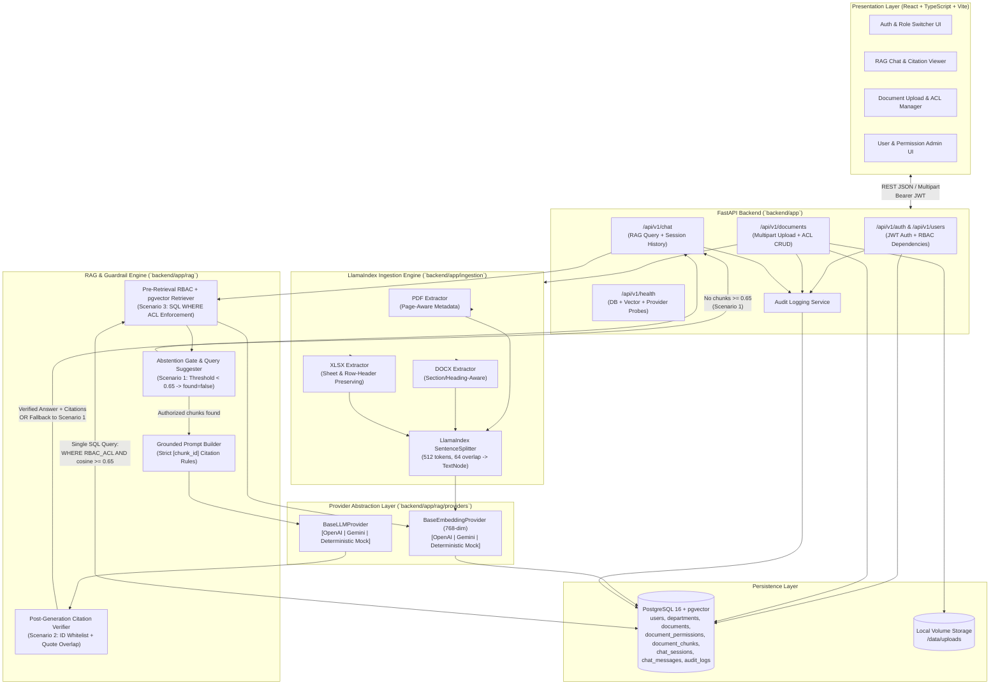
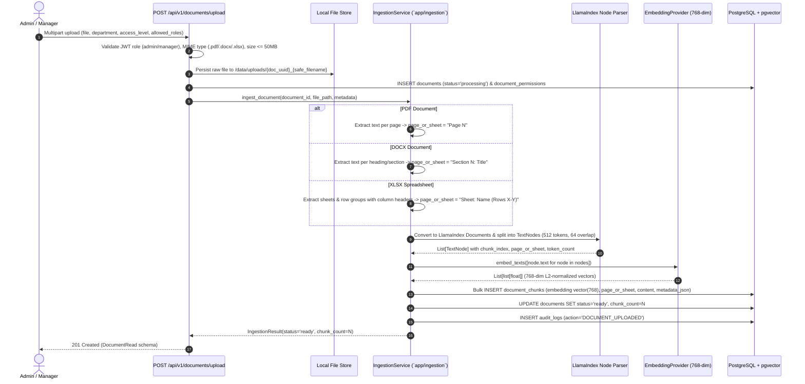
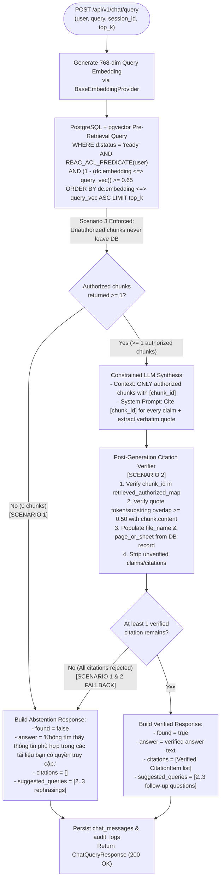

# System Architecture (`docs/ARCHITECTURE.md`)

> **Project**: Enterprise Knowledge Assistant  
> **Phase**: Phase 1 — System Architecture, Data Flows & Module Boundaries  
> **Owner**: `@architect`

---

## 1. High-Level System Architecture

The Enterprise Knowledge Assistant is a modular, container-ready full-stack application composed of a **React + TypeScript** single-page application, a **FastAPI (Python 3.11+)** backend with **LlamaIndex** ingestion and retrieval components, and a **PostgreSQL 16 + `pgvector`** unified relational and vector database.



---

## 2. Detailed Pipeline Data Flows

### 2.1 Document Ingestion Pipeline Flow

The ingestion pipeline transforms raw uploaded files (`.pdf`, `.docx`, `.xlsx`) into permission-tagged, structurally indexed 768-dimensional vector chunks stored transactionally in PostgreSQL.



---

### 2.2 RAG Query Pipeline & The Three Mandatory Scenarios

Every user query passes through three security and quality gates corresponding to the three mandatory scenarios:

1. **Gate 1 — Pre-Retrieval RBAC & Department ABAC SQL Filter (Scenario 3)**:
   - Evaluated inside PostgreSQL **before** vector similarity ranking.
   - Filters `documents` and `document_permissions` against `(user.id, user.role, user.department)`.
   - **Zero-Leakage Guarantee**: Unauthorized chunks are excluded by the SQL `WHERE` clause. They are never loaded into Python memory, never counted, and never revealed in error responses.
2. **Gate 2 — Pre-Generation Similarity Threshold & Abstention Gate (Scenario 1)**:
   - Evaluates whether at least one authorized chunk satisfies `similarity_score >= 0.65` (and passes keyword/topical sanity check).
   - If `len(authorized_chunks) == 0`:
     - Immediately short-circuits LLM generation (or uses a constrained query-rephrasing generator with zero document context).
     - Returns `found: false`, `answer: "Không tìm thấy thông tin phù hợp trong các tài liệu bạn có quyền truy cập."`, `citations: []`, and 2–3 contextual `suggested_queries`.
3. **Gate 3 — Post-Generation Citation Verifier (Scenario 2)**:
   - Parses the generated answer and structured citations.
   - Validates every `chunk_id` against the whitelist of retrieved authorized chunks from Gate 1.
   - Verifies lexical/semantic overlap between the cited `quote` / claim and the authoritative `chunk.content`.
   - Overwrites `file_name`, `document_id`, `page_or_sheet`, and `score` directly from the authoritative database record.
   - Rejects any fabricated `chunk_id` or ungrounded quote; if zero verified citations remain, falls back to **Scenario 1 (`found: false`)**.



---

## 3. Repository Structure & Strict Directory Ownership Table

To enable parallel engineering across the swarm without file collisions or merge conflicts, every directory and file has a **single designated owner agent**. No agent may modify files outside their owned paths.

### 3.1 Directory Layout

```text
d:/enterprise-knowledge-assistant/
├── ASSUMPTIONS.md                      # [architect] Phase 0 assumptions & defaults
├── README.md                           # [devops / qa_security] Runbook & setup guide
├── .env.example                        # [devops] Environment variable template
├── docker-compose.yml                  # [devops] Full-stack container orchestration
├── docs/
│   ├── ADR.md                          # [architect] Architectural Decision Records
│   ├── ARCHITECTURE.md                 # [architect] System architecture & ownership
│   ├── ERD.md                          # [architect] Database schema & DDL
│   ├── openapi.yaml                    # [architect] OpenAPI 3.1.0 specification
│   ├── CONTRACTS.md                    # [architect] Python module & schema contracts
│   └── REVIEWS.md                      # [reviewer] Phase gate sign-off reviews
├── infra/                              # [devops] Dockerfiles, init SQL, startup scripts
│   ├── backend.Dockerfile
│   ├── frontend.Dockerfile
│   └── postgres/
│       └── init.sql
├── backend/
│   ├── pyproject.toml                  # [devops / backend_core] Python dependencies
│   ├── requirements.txt                # [devops / backend_core] Pinned pip packages
│   └── app/
│       ├── __init__.py                 # [backend_core]
│       ├── main.py                     # [backend_core] FastAPI app factory & lifespan
│       ├── core/                       # [backend_core] Config, JWT, security, RBAC helpers
│       │   ├── __init__.py
│       │   ├── config.py
│       │   ├── security.py
│       │   └── exceptions.py
│       ├── db/                         # [backend_core] SQLAlchemy engine, ORM models, seed
│       │   ├── __init__.py
│       │   ├── session.py
│       │   ├── models.py
│       │   └── seed.py
│       ├── schemas/                    # [backend_core] Shared Pydantic v2 API models
│       │   ├── __init__.py
│       │   ├── common.py
│       │   ├── auth.py
│       │   ├── user.py
│       │   ├── document.py
│       │   └── chat.py
│       ├── api/                        # [backend_core] FastAPI routers & dependency injection
│       │   ├── __init__.py
│       │   ├── deps.py
│       │   └── v1/
│       │       ├── __init__.py
│       │       ├── router.py
│       │       ├── auth.py
│       │       ├── users.py
│       │       ├── documents.py
│       │       ├── chat.py
│       │       └── health.py
│       ├── ingestion/                  # [ingestion] LlamaIndex parsers, chunker, ingestion service
│       │   ├── __init__.py
│       │   ├── parsers/
│       │   │   ├── __init__.py
│       │   │   ├── pdf_parser.py
│       │   │   ├── docx_parser.py
│       │   │   └── xlsx_parser.py
│       │   ├── chunker.py
│       │   └── service.py
│       └── rag/                        # [rag_engineer] Providers, SQL RBAC retriever, verifier, orchestrator
│           ├── __init__.py
│           ├── providers/
│           │   ├── __init__.py
│           │   ├── base.py
│           │   ├── factory.py
│           │   ├── mock_provider.py
│           │   ├── openai_provider.py
│           │   └── gemini_provider.py
│           ├── retriever.py
│           ├── verifier.py
│           ├── prompts.py
│           └── service.py
├── frontend/                           # [frontend] React 18 + TypeScript + Tailwind/Vite UI
│   ├── package.json
│   ├── tsconfig.json
│   ├── vite.config.ts
│   ├── index.html
│   └── src/
│       ├── main.tsx
│       ├── App.tsx
│       ├── api/
│       ├── components/
│       ├── context/
│       ├── pages/
│       └── types/
└── tests/                              # [qa_security] Pytest suite & sample fixture documents
    ├── conftest.py
    ├── fixtures/
    ├── test_scenario1_not_found.py
    ├── test_scenario2_citation_verification.py
    ├── test_scenario3_rbac_unauthorized.py
    ├── test_ingestion_parsers.py
    └── test_api_endpoints.py
```

### 3.2 Strict Ownership Matrix

| Agent Role | Owned Paths (Read/Write) | Read-Only Dependencies | Forbidden Paths |
| :--- | :--- | :--- | :--- |
| **`@architect`** | `ASSUMPTIONS.md`, `docs/ADR.md`, `docs/ARCHITECTURE.md`, `docs/ERD.md`, `docs/openapi.yaml`, `docs/CONTRACTS.md` | All project files | Application code (`backend/`, `frontend/`, `infra/`, `tests/`) unless updating contracts |
| **`@reviewer`** | `docs/REVIEWS.md` | All project files | Any code or architecture file outside `docs/REVIEWS.md` |
| **`@backend_core`** | `backend/app/main.py`, `backend/app/core/**`, `backend/app/db/**`, `backend/app/schemas/**`, `backend/app/api/**`, `backend/requirements.txt`, `backend/pyproject.toml` | `docs/**`, `backend/app/ingestion/service.py`, `backend/app/rag/service.py` | `backend/app/ingestion/**`, `backend/app/rag/**`, `frontend/**`, `tests/**` |
| **`@ingestion`** | `backend/app/ingestion/**` | `docs/**`, `backend/app/core/config.py`, `backend/app/db/models.py`, `backend/app/schemas/document.py`, `backend/app/rag/providers/factory.py` | `backend/app/core/**`, `backend/app/db/**`, `backend/app/api/**`, `backend/app/rag/**` |
| **`@rag_engineer`** | `backend/app/rag/**` | `docs/**`, `backend/app/core/config.py`, `backend/app/db/models.py`, `backend/app/schemas/chat.py`, `backend/app/schemas/user.py` | `backend/app/core/**`, `backend/app/db/**`, `backend/app/api/**`, `backend/app/ingestion/**` |
| **`@frontend`** | `frontend/**` | `docs/openapi.yaml`, `docs/ARCHITECTURE.md` | `backend/**`, `infra/**`, `tests/**` |
| **`@devops`** | `docker-compose.yml`, `.env.example`, `infra/**`, `README.md` | `docs/**`, `backend/**`, `frontend/**` | `backend/app/**`, `frontend/src/**`, `tests/**` |
| **`@qa_security`** | `tests/**` | All project files | `docs/**` (except test reports if requested) |

---

## 4. Cross-Module Integration Rules

1. **Single Database Models Source of Truth**: `@backend_core` owns `backend/app/db/models.py` and `backend/app/schemas/*.py` following the exact definitions in `docs/ERD.md` and `docs/CONTRACTS.md`. `@ingestion` and `@rag_engineer` import ORM models from `app.db.models` and Pydantic schemas from `app.schemas`.
2. **Embedding Provider Sharing**: `@rag_engineer` implements `get_embedding_provider()` in `backend/app/rag/providers/factory.py`. `@ingestion` calls `get_embedding_provider()` (or receives an `BaseEmbeddingProvider` instance via dependency injection) to compute 768-dim chunk embeddings during document ingestion.
3. **Router-to-Service Wiring**: `@backend_core`'s routers (`backend/app/api/v1/documents.py` and `backend/app/api/v1/chat.py`) invoke `IngestionService.ingest_document(...)` from `app.ingestion.service` and `RAGService.query(...)` from `app.rag.service` using the exact signatures specified in `docs/CONTRACTS.md`.
