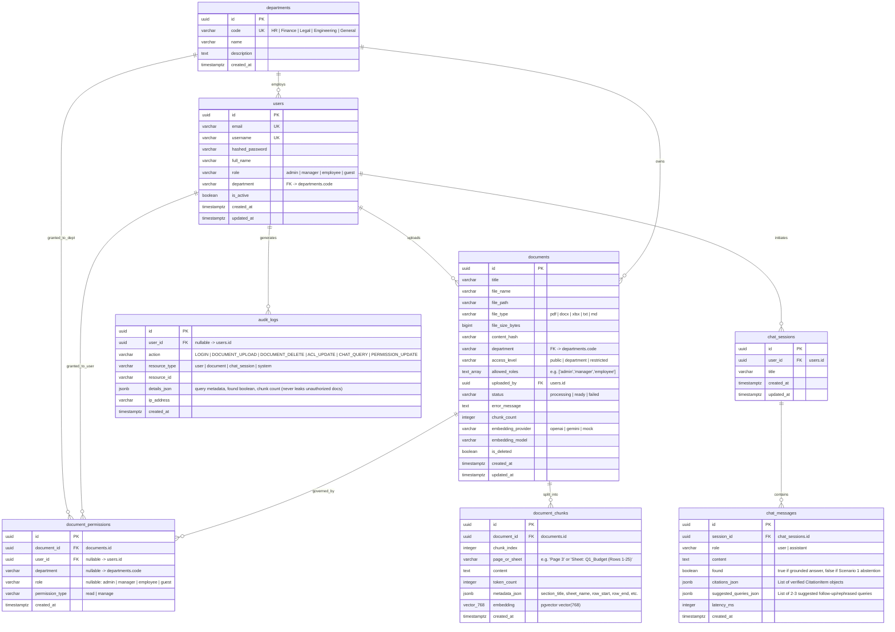

# Entity-Relationship Diagram & Database Schema (`docs/ERD.md`)

> **Project**: Enterprise Knowledge Assistant  
> **Phase**: Phase 1 — Database Schema, `pgvector` Indexes & Pre-Retrieval RBAC Design  
> **Owner**: `@architect`

---

## 1. Entity-Relationship Diagram (Mermaid)

The PostgreSQL 16 + `pgvector` database consists of 8 core tables designed to support transactional document management, fine-grained pre-retrieval RBAC + Department ABAC filtering, 768-dimensional vector similarity search, multi-turn chat history with citation auditability, and security audit logging.



---

## 2. Complete PostgreSQL 16 + `pgvector` SQL DDL

Below is the authoritative SQL DDL specification for initializing the database (`infra/postgres/init.sql` and SQLAlchemy models in `backend/app/db/models.py`).

```sql
-- ============================================================================
-- EXTENSIONS
-- ============================================================================
CREATE EXTENSION IF NOT EXISTS "uuid-ossp";
CREATE EXTENSION IF NOT EXISTS "vector";

-- ============================================================================
-- 1. TABLE: departments
-- ============================================================================
CREATE TABLE IF NOT EXISTS departments (
    id UUID PRIMARY KEY DEFAULT uuid_generate_v4(),
    code VARCHAR(50) NOT NULL UNIQUE
        CHECK (code IN ('HR', 'Finance', 'Legal', 'Engineering', 'General')),
    name VARCHAR(150) NOT NULL,
    description TEXT,
    created_at TIMESTAMPTZ NOT NULL DEFAULT NOW()
);

-- ============================================================================
-- 2. TABLE: users
-- ============================================================================
CREATE TABLE IF NOT EXISTS users (
    id UUID PRIMARY KEY DEFAULT uuid_generate_v4(),
    email VARCHAR(255) NOT NULL UNIQUE,
    username VARCHAR(100) NOT NULL UNIQUE,
    hashed_password VARCHAR(255) NOT NULL,
    full_name VARCHAR(200) NOT NULL,
    role VARCHAR(32) NOT NULL DEFAULT 'employee'
        CHECK (role IN ('admin', 'manager', 'employee', 'guest')),
    department VARCHAR(50) NOT NULL
        REFERENCES departments(code) ON UPDATE CASCADE,
    is_active BOOLEAN NOT NULL DEFAULT TRUE,
    created_at TIMESTAMPTZ NOT NULL DEFAULT NOW(),
    updated_at TIMESTAMPTZ NOT NULL DEFAULT NOW()
);

CREATE INDEX IF NOT EXISTS idx_users_role_dept ON users (role, department) WHERE is_active = TRUE;

-- ============================================================================
-- 3. TABLE: documents
-- ============================================================================
CREATE TABLE IF NOT EXISTS documents (
    id UUID PRIMARY KEY DEFAULT uuid_generate_v4(),
    title VARCHAR(500) NOT NULL,
    file_name VARCHAR(500) NOT NULL,
    file_path VARCHAR(1024) NOT NULL,
    file_type VARCHAR(32) NOT NULL
        CHECK (file_type IN ('pdf', 'docx', 'xlsx', 'txt', 'md')),
    file_size_bytes BIGINT NOT NULL CHECK (file_size_bytes > 0 AND file_size_bytes <= 52428800),
    content_hash VARCHAR(64) NOT NULL,
    department VARCHAR(50) NOT NULL
        REFERENCES departments(code) ON UPDATE CASCADE,
    access_level VARCHAR(32) NOT NULL DEFAULT 'department'
        CHECK (access_level IN ('public', 'department', 'restricted')),
    allowed_roles TEXT[] NOT NULL DEFAULT ARRAY['admin', 'manager', 'employee']::TEXT[],
    uploaded_by UUID NOT NULL
        REFERENCES users(id) ON DELETE RESTRICT,
    status VARCHAR(32) NOT NULL DEFAULT 'processing'
        CHECK (status IN ('processing', 'ready', 'failed')),
    error_message TEXT,
    chunk_count INTEGER NOT NULL DEFAULT 0,
    embedding_provider VARCHAR(32) NOT NULL DEFAULT 'mock',
    embedding_model VARCHAR(128) NOT NULL DEFAULT 'mock-768',
    is_deleted BOOLEAN NOT NULL DEFAULT FALSE,
    created_at TIMESTAMPTZ NOT NULL DEFAULT NOW(),
    updated_at TIMESTAMPTZ NOT NULL DEFAULT NOW()
);

-- B-Tree & GIN indexes for fast Pre-Retrieval RBAC filtering (Scenario 3)
CREATE INDEX IF NOT EXISTS idx_documents_rbac_filter
    ON documents (status, is_deleted, access_level, department);
CREATE INDEX IF NOT EXISTS idx_documents_allowed_roles_gin
    ON documents USING GIN (allowed_roles);

-- ============================================================================
-- 4. TABLE: document_permissions
-- ============================================================================
CREATE TABLE IF NOT EXISTS document_permissions (
    id UUID PRIMARY KEY DEFAULT uuid_generate_v4(),
    document_id UUID NOT NULL
        REFERENCES documents(id) ON DELETE CASCADE,
    user_id UUID
        REFERENCES users(id) ON DELETE CASCADE,
    department VARCHAR(50)
        REFERENCES departments(code) ON UPDATE CASCADE ON DELETE CASCADE,
    role VARCHAR(32)
        CHECK (role IS NULL OR role IN ('admin', 'manager', 'employee', 'guest')),
    permission_type VARCHAR(32) NOT NULL DEFAULT 'read'
        CHECK (permission_type IN ('read', 'manage')),
    created_at TIMESTAMPTZ NOT NULL DEFAULT NOW(),
    -- At least one principal selector must be non-null
    CONSTRAINT chk_document_permission_target
        CHECK (user_id IS NOT NULL OR department IS NOT NULL OR role IS NOT NULL)
);

CREATE INDEX IF NOT EXISTS idx_doc_perms_lookup
    ON document_permissions (document_id, permission_type, user_id, department, role);

-- ============================================================================
-- 5. TABLE: document_chunks
-- ============================================================================
CREATE TABLE IF NOT EXISTS document_chunks (
    id UUID PRIMARY KEY DEFAULT uuid_generate_v4(),
    document_id UUID NOT NULL
        REFERENCES documents(id) ON DELETE CASCADE,
    chunk_index INTEGER NOT NULL CHECK (chunk_index >= 0),
    page_or_sheet VARCHAR(255) NOT NULL,
    content TEXT NOT NULL,
    token_count INTEGER NOT NULL DEFAULT 0,
    metadata_json JSONB NOT NULL DEFAULT '{}'::JSONB,
    embedding vector(768) NOT NULL,
    created_at TIMESTAMPTZ NOT NULL DEFAULT NOW(),
    CONSTRAINT uq_document_chunk_index UNIQUE (document_id, chunk_index)
);

CREATE INDEX IF NOT EXISTS idx_document_chunks_doc_id
    ON document_chunks (document_id);

-- HNSW Index for fast cosine similarity search in pgvector
CREATE INDEX IF NOT EXISTS idx_document_chunks_embedding_hnsw
    ON document_chunks
    USING hnsw (embedding vector_cosine_ops)
    WITH (m = 16, ef_construction = 64);

-- ============================================================================
-- 6. TABLE: chat_sessions
-- ============================================================================
CREATE TABLE IF NOT EXISTS chat_sessions (
    id UUID PRIMARY KEY DEFAULT uuid_generate_v4(),
    user_id UUID NOT NULL
        REFERENCES users(id) ON DELETE CASCADE,
    title VARCHAR(300) NOT NULL DEFAULT 'Cuộc hội thoại mới',
    created_at TIMESTAMPTZ NOT NULL DEFAULT NOW(),
    updated_at TIMESTAMPTZ NOT NULL DEFAULT NOW()
);

CREATE INDEX IF NOT EXISTS idx_chat_sessions_user_id
    ON chat_sessions (user_id, updated_at DESC);

-- ============================================================================
-- 7. TABLE: chat_messages
-- ============================================================================
CREATE TABLE IF NOT EXISTS chat_messages (
    id UUID PRIMARY KEY DEFAULT uuid_generate_v4(),
    session_id UUID NOT NULL
        REFERENCES chat_sessions(id) ON DELETE CASCADE,
    role VARCHAR(32) NOT NULL CHECK (role IN ('user', 'assistant')),
    content TEXT NOT NULL,
    found BOOLEAN,
    citations_json JSONB NOT NULL DEFAULT '[]'::JSONB,
    suggested_queries_json JSONB NOT NULL DEFAULT '[]'::JSONB,
    latency_ms INTEGER,
    created_at TIMESTAMPTZ NOT NULL DEFAULT NOW()
);

CREATE INDEX IF NOT EXISTS idx_chat_messages_session_id
    ON chat_messages (session_id, created_at ASC);

-- ============================================================================
-- 8. TABLE: audit_logs
-- ============================================================================
CREATE TABLE IF NOT EXISTS audit_logs (
    id UUID PRIMARY KEY DEFAULT uuid_generate_v4(),
    user_id UUID
        REFERENCES users(id) ON DELETE SET NULL,
    action VARCHAR(64) NOT NULL,
    resource_type VARCHAR(64) NOT NULL,
    resource_id VARCHAR(128),
    details_json JSONB NOT NULL DEFAULT '{}'::JSONB,
    ip_address VARCHAR(64),
    created_at TIMESTAMPTZ NOT NULL DEFAULT NOW()
);

CREATE INDEX IF NOT EXISTS idx_audit_logs_user_action
    ON audit_logs (user_id, action, created_at DESC);
```

---

## 3. How the Schema Enforces the Three Mandatory Scenarios

### 3.1 Scenario 3 (Pre-Retrieval RBAC & Department ABAC Filtering)
- **`documents.access_level` (`public | department | restricted`)**, **`documents.department`**, and **`documents.allowed_roles` (`TEXT[]`)** provide fast primary filtering directly on the `documents` table using `idx_documents_rbac_filter` and `idx_documents_allowed_roles_gin`.
- **`document_permissions`** enables fine-grained ACL grants for `restricted` (or cross-department) documents by `user_id`, `department`, and/or `role`.
- During retrieval (`backend/app/rag/retriever.py`), `document_chunks` is joined with `documents` and filtered by the RBAC predicate **inside the SQL `WHERE` clause** before computing `(1 - (dc.embedding <=> :query_embedding)) >= :similarity_threshold` and `ORDER BY dc.embedding <=> :query_embedding ASC LIMIT :top_k`.
- Because unauthorized rows fail the `WHERE` predicate inside PostgreSQL, their embeddings and text content are never returned to the Python application.

### 3.2 Scenario 2 (Post-Generation Citation Verification)
- **`document_chunks.id` (`chunk_id`)** is a globally unique UUID assigned at ingestion time.
- **`document_chunks.page_or_sheet`** stores the exact page number (`"Page 4"`), section header (`"Section 2.1"`), or Excel sheet & row range (`"Sheet: Luong_2026 (Rows 1-20)"`).
- **`document_chunks.content`** holds the authoritative chunk text against which the **Post-Generation Citation Verifier** checks quote containment and token overlap.
- **`chat_messages.citations_json`** persists the verified citation payloads (`document_id`, `file_name`, `page_or_sheet`, `chunk_id`, `quote`, `score`, `verification_status`) for full auditability.

### 3.3 Scenario 1 (Abstention When No Authorized Info Found)
- **`chat_messages.found`** records `FALSE` whenever pre-retrieval filtering + similarity threshold (`>= 0.65`) yields 0 chunks (or when post-generation citation verification rejects all candidate citations).
- **`chat_messages.suggested_queries_json`** persists the 2–3 suggested query rephrasings returned alongside the standard abstention message `"Không tìm thấy thông tin phù hợp trong các tài liệu bạn có quyền truy cập."`.

---

## 4. Default Seed Data Specification (`backend/app/db/seed.py`)

To support out-of-the-box demos and automated test suites for all 3 mandatory scenarios, `backend/app/db/seed.py` must idempotently seed:
1. **5 Departments**: `HR`, `Finance`, `Legal`, `Engineering`, `General`.
2. **5 Default Users** (password for all demo users: `Password123!`):
   - `admin@company.vn` (`role="admin"`, `department="General"`)
   - `hr.manager@company.vn` (`role="manager"`, `department="HR"`)
   - `finance.manager@company.vn` (`role="manager"`, `department="Finance"`)
   - `eng.employee@company.vn` (`role="employee"`, `department="Engineering"`)
   - `guest@company.vn` (`role="guest"`, `department="General"`)
3. **Initial Sample Documents** covering:
   - A `public` company handbook (`Quy_che_lam_viec_chung.pdf` / `.md`, `department="General"`, `access_level="public"`, `allowed_roles=["admin","manager","employee","guest"]`).
   - A `department`-scoped Engineering guide (`Huong_dan_ky_thuat_he_thong.docx`, `department="Engineering"`, `access_level="department"`, `allowed_roles=["admin","manager","employee"]`).
   - A `restricted` HR executive compensation policy (`Chinh_sach_luong_thuong_cap_cao_HR.xlsx`, `department="HR"`, `access_level="restricted"`, `allowed_roles=["admin","manager"]`, with `document_permissions` granted only to `hr.manager@company.vn` / `HR` managers).
